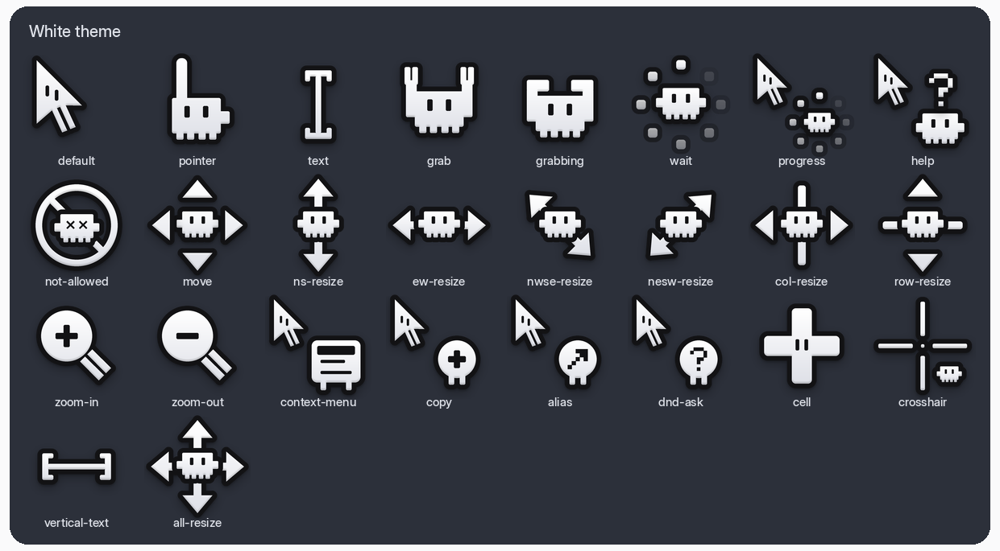
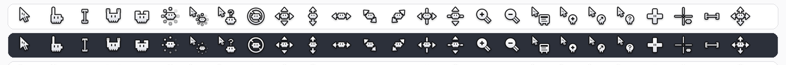
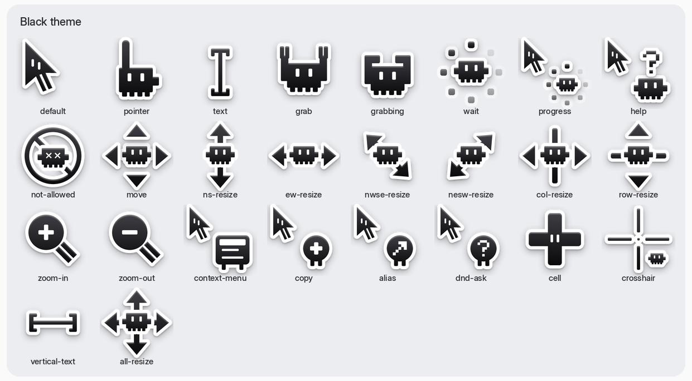
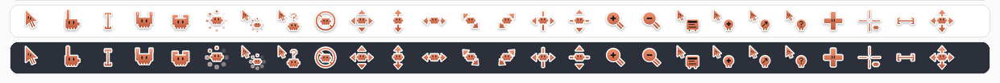

# Clawd Cursors Pack

Pixel-critter cursors with macOS Tahoe–style outlines and shadows, for Linux (Xcursor).
Every cursor is animated. The pack comes in three colors, and each color has its own folder.

| Theme | Folder | Best on |
| --- | --- | --- |
| Clawd Tahoe White | [`clawd-tahoe-white/`](clawd-tahoe-white/) | dark backgrounds |
| Clawd Tahoe Black | [`clawd-tahoe-black/`](clawd-tahoe-black/) | light backgrounds |
| Clawd Tahoe Orange | [`clawd-tahoe-orange/`](clawd-tahoe-orange/) | any background |

## Previews

### White




### Black




### Orange




The full design sheet is in [`clawd_tahoe_v4.png`](clawd_tahoe_v4.png).

## Included cursors

`default` (`left_ptr`), `pointer`, `text`, `grab`, `grabbing`, `move`, `wait`, `progress`, `help`,
`not-allowed`, `ns-resize`, `ew-resize`, `nwse-resize`, `nesw-resize`, `col-resize`, `row-resize`,
`zoom-in`, `zoom-out`, `context-menu`, `copy`, `alias`, `dnd-ask`, `cell`, `crosshair`,
`vertical-text`, `all-resize`

Each theme also includes symlinks for the old X11 cursor names and the hash-based names, so older apps show the right cursor.

## Install

Copy the theme folders you want into your user icon directory. `cp -a` keeps the alias symlinks:

```bash
mkdir -p ~/.local/share/icons && cp -a clawd-tahoe-* ~/.local/share/icons/
```

To install for all users, copy to `/usr/share/icons/` with root and make the files readable by everyone:

```bash
sudo cp -a clawd-tahoe-* /usr/share/icons/ && sudo chmod -R u=rwX,go=rX /usr/share/icons/clawd-tahoe-*
```

Then pick the theme:

- **GNOME**: GNOME Tweaks → Appearance → Cursor, or
  ```bash
  gsettings set org.gnome.desktop.interface cursor-theme 'clawd-tahoe-orange'
  ```
- **KDE Plasma**: System Settings → Colors & Themes → Cursors
- **Other / X11**: set `Xcursor.theme: clawd-tahoe-orange` in `~/.Xresources`, or put
  `Inherits=clawd-tahoe-orange` in `~/.local/share/icons/default/index.theme`

If some apps still show the old cursor, log out and back in.

> Each theme sets `Inherits=tahoe`. Any cursor missing from this pack comes from a `tahoe` cursor theme, if one is installed.
