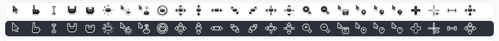
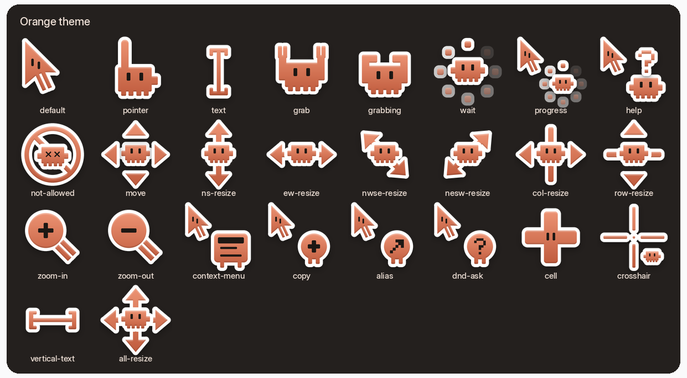

# Clawd Cursors Pack

Pixel-critter cursors with macOS Tahoe–style outlines and shadows, for Linux (Xcursor) and Windows (.ani).
Every cursor is animated. The pack comes in three colors.

| Theme | Linux | Windows | Best on |
| --- | --- | --- | --- |
| Clawd Tahoe White | [`linux/clawd-tahoe-white/`](linux/clawd-tahoe-white/) | [`windows/clawd-tahoe-white/`](windows/clawd-tahoe-white/) | dark backgrounds |
| Clawd Tahoe Black | [`linux/clawd-tahoe-black/`](linux/clawd-tahoe-black/) | [`windows/clawd-tahoe-black/`](windows/clawd-tahoe-black/) | light backgrounds |
| Clawd Tahoe Orange | [`linux/clawd-tahoe-orange/`](linux/clawd-tahoe-orange/) | [`windows/clawd-tahoe-orange/`](windows/clawd-tahoe-orange/) | any background |

## Previews

### White


### Black




### Orange




The full design sheet is in [`clawd_tahoe_v4.png`](clawd_tahoe_v4.png).

## Folder layout

```
linux/clawd-tahoe-<color>/      index.theme + cursors/ (Xcursor files)
windows/clawd-tahoe-<color>/    .ani cursors + install.inf
previews/                       preview images used in this README
tools/build_windows.py          regenerates windows/ from linux/
```

## Included cursors

`default` (`left_ptr`), `pointer`, `text`, `grab`, `grabbing`, `move`, `wait`, `progress`, `help`,
`not-allowed`, `ns-resize`, `ew-resize`, `nwse-resize`, `nesw-resize`, `col-resize`, `row-resize`,
`zoom-in`, `zoom-out`, `context-menu`, `copy`, `alias`, `dnd-ask`, `cell`, `crosshair`,
`vertical-text`, `all-resize`

On Linux, each theme also includes symlinks for the old X11 cursor names and the hash-based names, so older apps show the right cursor.
Windows supports fewer cursors; see [the Windows mapping](#install-on-windows-10--11).

## Download

Clone the repository:

```bash
git clone https://github.com/SeulKing-Ja/Clawd-cursors-pack.git && cd Clawd-cursors-pack
```

Or on GitHub click **Code → Download ZIP** and extract it. Use only the `linux/` or the `windows/` folder, whichever matches your system.

## Install on Linux

From the `Clawd-cursors-pack` folder, copy the theme folders you want into your user icon directory. `cp -a` keeps the alias symlinks:

```bash
mkdir -p ~/.local/share/icons && cp -a linux/clawd-tahoe-* ~/.local/share/icons/
```

To install for all users, copy to `/usr/share/icons/` with root and make the files readable by everyone:

```bash
sudo cp -a linux/clawd-tahoe-* /usr/share/icons/ && sudo chmod -R u=rwX,go=rX /usr/share/icons/clawd-tahoe-*
```

Then pick the theme:

- **GNOME**: GNOME Tweaks → Appearance → Cursor, or
  ```bash
  gsettings set org.gnome.desktop.interface cursor-theme 'clawd-tahoe-orange'
  ```
- **KDE Plasma**: System Settings → Colors & Themes → Cursors
- **Other / X11**: set `Xcursor.theme: clawd-tahoe-orange` in `~/.Xresources`, or put
  `Inherits=clawd-tahoe-orange` in `~/.local/share/icons/default/index.theme`

If some apps still show the old cursor, log out and back in.

> Each theme sets `Inherits=tahoe`. Any cursor missing from this pack comes from a `tahoe` cursor theme, if one is installed.

## Install on Windows 10 / 11

1. [Download](#download) the pack and extract the ZIP (cursors cannot be installed from inside a zip).
2. Open `Clawd-cursors-pack\windows\clawd-tahoe-<color>\`, right-click `install.inf` and choose **Install**
   (on Windows 11: **Show more options → Install**). Accept the prompt.
3. Open **Settings → Bluetooth & devices → Mouse → Additional mouse settings → Pointers**,
   choose **Clawd Tahoe &lt;Color&gt;** under *Scheme*, then click **Apply**.

The files are copied to `C:\Windows\Cursors\Clawd Tahoe <Color>\`. Each cursor includes 32, 48, 64, 72 and 96 px versions,
so it stays sharp at 100 %, 150 %, 200 %, 225 % and 300 % display scaling. At 125 % and 175 % Windows resizes
the nearest version, so the pixel art may look slightly soft.

Windows has only 17 cursor slots, so the pack maps to them like this:

| Windows slot | Clawd cursor |
| --- | --- |
| Normal Select, Alternate Select | default |
| Help Select | help |
| Working in Background | progress |
| Busy | wait |
| Precision Select | crosshair |
| Text Select | text |
| Link Select, Handwriting, Location Select, Person Select | pointer |
| Unavailable | not-allowed |
| Vertical / Horizontal Resize | ns-resize / ew-resize |
| Diagonal Resize 1 / 2 | nwse-resize / nesw-resize |
| Move | move |

`grab`, `zoom-in`, `copy`, `cell` and the other extra cursors have no Windows slot. Apps that need them draw their own.

**Uninstall:** in *Pointers*, pick another scheme (e.g. *Windows Default*), select the Clawd scheme, click **Delete**,
then remove `C:\Windows\Cursors\Clawd Tahoe <Color>\`.

### Rebuilding the Windows cursors

After changing the Linux cursors, regenerate the Windows files (Python 3, no extra packages):

```bash
python3 tools/build_windows.py
```
